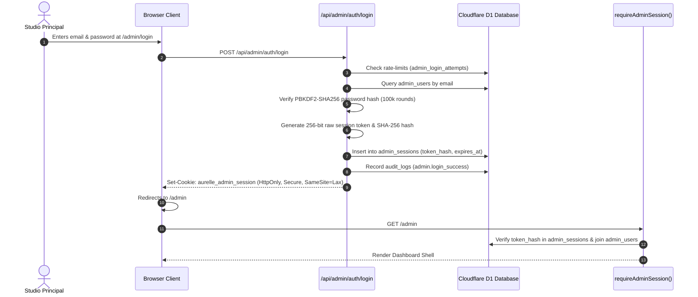

# Administrative Authentication, RBAC & Dashboard Architecture

**Project:** Aurelle Spaces  
**Organization:** DRK Information Software Solutions  
**Deployment Target:** Cloudflare Workers, Cloudflare D1 (SQLite)  
**Production URL:** `https://aurelle.dsecops88.online`  
**Document Revision:** Prompt 08 — Version 1.0  

---

## 1. Executive Summary & Security Principles

The Aurelle Spaces administrative console (`/admin`) provides studio principals, architects, and editorial curators with a secure management interface completely separated from the public-facing architectural website.

Key security tenets:
1. **Zero Node.js C++ Binaries:** Password hashing and session cryptography utilize the standard W3C Web Crypto API (`crypto.subtle`), natively executing at sub-millisecond speeds across Cloudflare Workers.
2. **Hashed Session Tokens:** Only the SHA-256 hash of the 256-bit random session token is persisted in Cloudflare D1 (`admin_sessions`). Even if the database is inspected, raw session tokens cannot be derived or hijacked.
3. **Defense in Depth & RBAC:** Access control enforces explicit server-side authorization checks that default to denying access.
4. **Login Abuse Protection:** Cloudflare D1-backed rate limiting throttles brute-force attempts to a maximum of 5 failed attempts per 15-minute window per IP and email.
5. **No Public Registration:** Self-registration is strictly disabled. Initial admin accounts are provisioned via secure deployment-time CLI execution.

---

## 2. Authentication Flow & Session Lifecycle



---

## 3. Cryptographic Implementation Details

### Password Hashing (PBKDF2-SHA256)
- **Algorithm:** PBKDF2 with HMAC-SHA256.
- **Iterations:** 100,000 rounds.
- **Salt:** 16 cryptographically secure random bytes generated via `crypto.getRandomValues`.
- **Key Length:** 256 bits (32 bytes).
- **Format:** `pbkdf2:sha256:100000:<salt_hex>:<hash_hex>`.
- **Verification:** Constant-time comparison using bitwise XOR to mitigate side-channel timing attacks.

### Session Token Security
- **Token Generation:** 32 random bytes (256 bits of entropy) encoded as a 64-character hex string.
- **Database Storage:** Stored as `token_hash = SHA256(rawToken)`.
- **Cookie Attributes:**
  - Name: `aurelle_admin_session`
  - `HttpOnly`: `true` (inaccessible to client-side JavaScript / XSS)
  - `Secure`: `true` in production (enforces HTTPS)
  - `SameSite`: `Lax` (protects against cross-site request forgery)
  - `Path`: `/`
  - `Max-Age`: 7 days (604,800 seconds)

---

## 4. Role-Based Access Control (RBAC) Matrix

Permissions are centrally defined in `src/lib/security/rbac.ts` and enforced server-side on all data mutations and views:

| Permission | Description | Super Admin | Editor | Viewer |
| :--- | :--- | :---: | :---: | :---: |
| `cms:read` | View portfolio, services, and articles | ✓ | ✓ | ✓ |
| `cms:write` | Create and edit draft content | ✓ | ✓ | ✗ |
| `cms:publish` | Publish or archive CMS monographs | ✓ | ✓ | ✗ |
| `cms:delete` | Delete portfolio or article records | ✓ | ✗ | ✗ |
| `media:read` | Browse R2 media asset library | ✓ | ✓ | ✓ |
| `media:upload`| Upload photography to R2 bucket | ✓ | ✓ | ✗ |
| `media:delete`| Delete assets from R2 bucket | ✓ | ✗ | ✗ |
| `enquiries:read`| Review incoming consultation briefs | ✓ | ✓ | ✓ |
| `enquiries:write`| Update enquiry status or triage notes | ✓ | ✓ | ✗ |
| `enquiries:assign`| Assign enquiries to specific architects | ✓ | ✗ | ✗ |
| `chat:read` | Inspect chatbot conversation history | ✓ | ✓ | ✓ |
| `automations:read`| View n8n webhook queue & events | ✓ | ✗ | ✗ |
| `automations:manage`| Retry or flush automation events | ✓ | ✗ | ✗ |
| `admin_users:manage`| Provision admins, alter account roles | ✓ | ✗ | ✗ |
| `audit:read` | Inspect security audit trails | ✓ | ✗ | ✗ |
| `settings:manage`| Alter studio configurations | ✓ | ✗ | ✗ |

---

## 5. Rate Limiting & Abuse Prevention

Administrative sign-in attempts are tracked in the `admin_login_attempts` table (`migrations/0003_admin_sessions.sql`):
- **Threshold:** Maximum 5 failed attempts within any 15-minute sliding window.
- **Scope:** Evaluated both per normalized email address and per client IP address (`cf-connecting-ip`).
- **Response:** Exceeding the threshold yields an HTTP 429 response: *"Too many failed attempts. Please try again in 15 minutes."*
- **Generic Responses:** Failed credentials return a generic message: *"Invalid email or password."* to prevent username/email enumeration.

---

## 6. Secure Administrator Provisioning Strategy

To maintain strict operational security, Aurelle Spaces does **not** expose public admin registration forms or default credentials.

### Production Provisioning Procedure:
1. Generate initial administrator credentials using the server utility in `src/lib/security/provisioning.ts`:
   ```typescript
   import { prepareAdminUserSeed } from "@/lib/security/provisioning";

   const seed = await prepareAdminUserSeed({
     email: "director@aurelle.dsecops88.online",
     password: "<SECURE_PASSPHRASE_MIN_12_CHARS>",
     displayName: "Studio Director",
     role: "super_admin",
   });
   console.log(seed.sqlInsertStatement);
   ```
2. Execute the generated SQL statement directly into the production Cloudflare D1 database via the Wrangler CLI:
   ```bash
   npx wrangler d1 execute aurelle-db --remote --command="INSERT INTO admin_users ..."
   ```
3. Never check plain-text administrator passwords into version control.

---

## 7. Cloudflare Deployment Checklist

When deploying to production in Prompts 18–20:
- [ ] Apply migration `0001_initial_schema.sql` to D1.
- [ ] Apply migration `0002_demonstration_seed.sql` to D1.
- [ ] Apply migration `0003_admin_sessions.sql` to D1.
- [ ] Execute initial Super Admin provisioning SQL statement.
- [ ] Verify `AUTH_SECRET` is configured via `wrangler secret put AUTH_SECRET`.
- [ ] Ensure custom domain routes in `wrangler.jsonc` point to `aurelle.dsecops88.online`.

