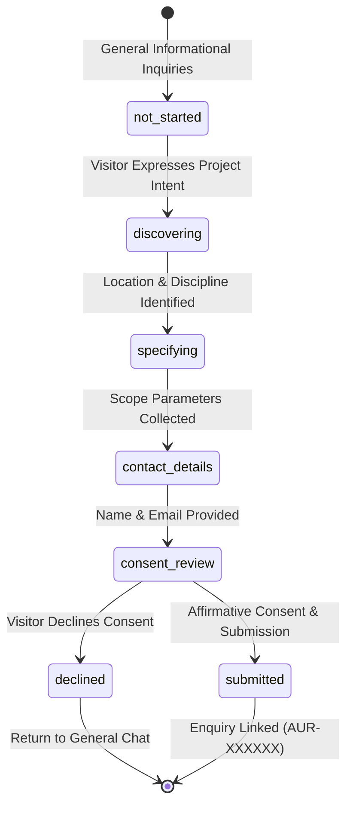

# AI Lead Qualification, Explicit Consent & Chatbot-to-Enquiry Architecture
**Project:** Aurelle Spaces — Premium Architecture & Interior Design Studio  
**Production Domain:** `https://aurelle.dsecops88.online`  
**Implemented In:** Prompt 13 of 20  
**Status:** Complete (Edge D1 & Real Enquiry Pipeline Connected)

---

## 1. Executive Architecture Overview

The **Aurelle Spaces AI Lead Qualification Engine** transforms the studio chatbot from a purely informational assistant into an intelligent, respectful, consent-driven intake conduit.

### Key Architectural Tenets:
1. **Respectful Intent Detection:** General questions about studio philosophy, case studies, or design materials remain frictionless and informational. Qualification begins only when a visitor demonstrates explicit intent to plan, design, or discuss a project.
2. **Progressive, Non-Intrusive Extraction:** Information is gathered naturally through unhurried dialogue rather than demanding an intimidating multi-field form upfront.
3. **Mandatory Affirmative Privacy Consent:** An enquiry is NEVER created silently or automatically. The visitor must grant explicit, un-preselected consent to allow the studio to process their contact details and reach out.
4. **Visitor Review & Correction:** Before submission, a structured summary card (`LeadQualificationCard`) renders in the conversation stream, allowing the visitor to edit any detail or decline.
5. **Single Canonical Enquiry Store:** Chat-originated leads persist directly into the existing Cloudflare D1 `enquiries` table with `enquiry_source = 'ai_chatbot'`. No secondary lead silos or conflicting databases exist.
6. **Bidirectional Association & Provenance:** Conversations and enquiries are bidirectionally linked via `chat_conversations.linked_enquiry_id` and `enquiries.conversation_id`.
7. **Downstream Automation Readiness:** Upon confirmed creation, an immutable event (`enquiry.created`) is enqueued into `automation_events` in Cloudflare D1 for subsequent n8n webhook processing (Prompt 14) and transactional email notifications (Prompt 15).

---

## 2. Lead Qualification Lifecycle & State Model



### Stage Definitions (`LeadQualificationStage`):
| Stage | Description | Trigger / Condition |
|---|---|---|
| `not_started` | Visitor asks informational questions. | Default initial state. |
| `discovering` | Visitor mentions wanting to design/renovate. | Intent patterns matched (e.g. *"I want to design my new home"*). |
| `specifying` | Studio collects property typology, area, budget. | Extracted city, discipline, or scope details. |
| `contact_details` | Scope outlined; contact details requested. | User provides name, email, or mobile number. |
| `consent_review` | Interactive review card displayed with privacy prompt. | Basic contact & project details assembled. |
| `submitted` | Enquiry persisted in Cloudflare D1. | Explicit consent granted and form confirmed. |
| `declined` | Visitor opts out of lead submission. | Visitor clicks *"Continue Chatting"* without submitting. |

---

## 3. Database Schema Migration (`0005_chat_lead_qualification.sql`)

```sql
-- 1. Extend chat_conversations with linked enquiry and structured state
ALTER TABLE chat_conversations ADD COLUMN linked_enquiry_id TEXT REFERENCES enquiries(id) ON DELETE SET NULL;
ALTER TABLE chat_conversations ADD COLUMN lead_state TEXT;
CREATE INDEX IF NOT EXISTS idx_chat_conversations_enquiry ON chat_conversations(linked_enquiry_id);

-- 2. Extend enquiries with originating conversation link
ALTER TABLE enquiries ADD COLUMN conversation_id TEXT REFERENCES chat_conversations(id) ON DELETE SET NULL;
CREATE INDEX IF NOT EXISTS idx_enquiries_conversation ON enquiries(conversation_id);
```

---

## 4. Chatbot-to-Enquiry API Contract: `POST /api/chat/enquiry`

### Endpoint Specification
* **Route:** `/api/chat/enquiry`
* **Method:** `POST`
* **Content-Type:** `application/json`
* **Max Payload Size:** 32 KB

### Request Payload (`CreateChatEnquiryRequest`)
```typescript
interface CreateChatEnquiryRequest {
  conversationId: string;
  leadData: {
    fullName: string;
    email: string;
    mobileNumber?: string;
    city: string;
    projectType: string;
    propertyType?: string;
    approximateArea?: string;
    budgetRange?: string;
    expectedTimeline?: string;
    projectDescription: string;
  };
  consentGiven: boolean; // Must be strictly true
  idempotencyKey?: string;
}
```

### Response Format (HTTP 201 Created)
```json
{
  "success": true,
  "enquiryId": "enq_7a8b9c0d1e2f3a4b",
  "referenceCode": "AUR-2F3A4B",
  "message": "Thank you. Your project enquiry has been received. The team can review the details you shared and contact you using the information provided."
}
```

---

## 5. Security & Prompt Injection Safeguards

1. **Session Ownership Enforcement:**
   - Every conversion request verifies that the `aurelle_chat_session` HTTP-only cookie matches the conversation's owner `session_id`.
   - Cross-visitor or forged conversation submissions are rejected with HTTP 403 Forbidden.
2. **Server-Side Validation:**
   - Client-submitted data is treated as untrusted. All fields pass through `validateServerEnquiry`.
   - Name must be >= 2 characters; email must be a valid RFC 5322 address; city must be non-empty; project description must be >= 10 characters.
3. **No Direct Model DB Writes:**
   - The LLM only assists with textual understanding. It has zero capability to trigger database mutations directly.
4. **Duplicate Submission Protection:**
   - Client sends a unique `idempotencyKey`.
   - Backend checks `enquiriesRepository.findRecentDuplicate(email, projectType, 5)` to prevent network double-submits.

---

## 6. Privacy & Consent Protocol

### Explicit Consent Wording
> *"May we save these details so the Aurelle Spaces team can review your enquiry and contact you about your project?"*
- Features an un-preselected checkbox and link to [/privacy-policy](/privacy-policy).
- If the visitor declines or dismisses the card, the assistant respects their choice:
  > *"Understood. We respect your choice. Feel free to continue exploring our portfolio, services, or ask any architectural questions. If you ever wish to discuss a project in the future, you can visit our Contact page at any time."*
- No lead or automation event is recorded on declined consent.

---

## 7. Administrative Integration (`/admin/enquiries` & `/admin/chat`)

1. **Admin Enquiries View (`/admin/enquiries`):**
   - Displays an **"AI Chatbot"** source badge alongside traditional web contact briefs.
   - Shows customer name, discipline, budget, city, assigned architect, and submission date.
2. **Enquiry Detail View (`/admin/enquiries/[id]`):**
   - Details display the `ai_chatbot` provenance badge and client timeline.
3. **Admin Chat Monitor (`/admin/chat`):**
   - Displays conversation status: `active`, `qualified_lead`, `resolved`.
   - Displays clickable **Linked Enquiry** link (`AUR-XXXXXX`) leading directly to the triage detail view.

---

## 8. Downstream Automation Event Dispatch (`automation_events`)

Upon confirmed D1 insertion, the endpoint enqueues:
```typescript
await automationRepository.createEvent(db, {
  eventType: "enquiry.created",
  relatedEntityId: enquiry.id,
  payloadReference: JSON.stringify({
    enquiryId: enquiry.id,
    referenceCode: `AUR-${enquiry.id.slice(-6).toUpperCase()}`,
    source: "ai_chatbot",
    fullName: enquiry.full_name,
    email: enquiry.email,
    city: enquiry.city,
    projectType: enquiry.project_type,
    submittedAt: new Date().toISOString(),
  }),
});
```
This event powers:
- **Prompt 14:** n8n Workflow Automation (CRM synchronization, lead triage).
- **Prompt 15:** Transactional Email Notifications (client confirmation receipt & studio principal notification).

