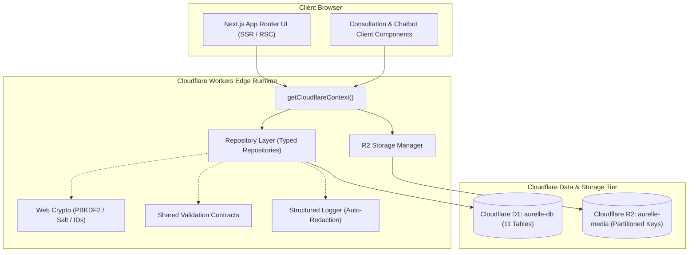

# Backend Data, Storage & Security Architecture

**Project:** Aurelle Spaces  
**Organization:** DRK Information Software Solutions  
**Deployment Target:** Cloudflare Workers, Cloudflare D1 (SQLite), Cloudflare R2  
**Production URL:** `https://aurelle.dsecops88.online`  
**Document Revision:** Prompt 07 — Version 1.0  

---

## 1. Overview & Architectural Principles

Aurelle Spaces utilizes a modern, serverless edge architecture powered by Cloudflare Workers and Next.js App Router (`@opennextjs/cloudflare`). To deliver sub-50ms latency across global and Indian edge points of presence, the data and storage layer is designed around native edge primitives:

- **Relational Data:** Cloudflare D1 (distributed serverless SQLite at the edge).
- **Object & Media Storage:** Cloudflare R2 (S3-compatible, zero egress fees, edge-bound).
- **Cryptographic Security:** Standard Web Crypto API (`crypto.subtle` PBKDF2-SHA256), free of native Node.js C++ bindings.
- **Data Access:** Strongly typed, parameterized repositories preventing SQL injection and separating queries from presentation logic.



---

## 2. Relational Database Schema (Cloudflare D1)

The database schema is defined in versioned SQLite DDL (`migrations/0001_initial_schema.sql`) and comprises 11 structured entities:

| Table | Primary Key | Purpose | Key Indices & Constraints |
| :--- | :--- | :--- | :--- |
| `admin_users` | `id` (`usr_...`) | Studio administrators and editors | UNIQUE(`email`), INDEX(`role`) |
| `services` | `id` (`srv_...`) | Architectural & interior disciplines | UNIQUE(`slug`), INDEX(`status`, `sort_order`) |
| `projects` | `id` (`prj_...`) | Portfolio case studies | UNIQUE(`slug`), INDEX(`category`), INDEX(`publication_status`, `featured`) |
| `media_assets` | `id` (`med_...`) | R2 media asset catalog | UNIQUE(`r2_object_key`), INDEX(`mime_type`) |
| `project_media` | `id` (`prm_...`) | Project-to-media gallery mapping | UNIQUE(`project_id`, `media_asset_id`), FK CASCADE |
| `journal_articles` | `id` (`art_...`) | Editorial essays & monographs | UNIQUE(`slug`), INDEX(`publication_status`, `published_at`), FK `cover_media_id` |
| `enquiries` | `id` (`enq_...`) | Client consultation briefs | INDEX(`status`), INDEX(`created_at`), INDEX(`email`) |
| `chat_conversations`| `id` (`cnv_...`) | Anonymous conversational sessions | UNIQUE(`session_id`), INDEX(`conversation_status`) |
| `chat_messages` | `id` (`msg_...`) | Conversational chat history | INDEX(`conversation_id`, `created_at`), FK CASCADE |
| `automation_events` | `id` (`evt_...`) | Outbound n8n/email dispatch queue| INDEX(`processing_status`, `next_retry_at`), INDEX(`related_entity_id`) |
| `audit_logs` | `id` (`aud_...`) | Immutable administrative audit log | INDEX(`entity_type`, `entity_id`), INDEX(`actor_id`, `created_at`) |

### Key Entity Relationships
- **Projects & Media:** Projects link to Media Assets via the many-to-many junction table `project_media` with an explicit `sort_order`, caption, and alt text.
- **Articles & Media:** Journal articles reference a primary cover asset in `media_assets` with `ON DELETE SET NULL`.
- **Enquiries & Admins:** Enquiries optionally assign to an `admin_users(id)` with `ON DELETE SET NULL`.
- **Chat Conversations & Messages:** Messages cascade-delete with their parent conversation.
- **Audit Logs:** Track all modifications across entities while strictly stripping credentials, tokens, and PII.

---

## 3. Storage Hierarchy & Media Security Model (Cloudflare R2)

Cloudflare R2 stores binary media assets without public bucket exposure. Key partitioning guarantees organization and safe access:

```
aurelle-media/
├── projects/{year}/{slug}/{uniqueId}-{filename}   # High-resolution architectural photography
├── journal/{year}/{slug}/{uniqueId}-{filename}    # Editorial monograph plates
├── general/{year}/{uniqueId}-{filename}           # Studio branding, icons, textures
└── private/{year}/{uniqueId}-{filename}           # Confidential client briefs, contracts
```

### Media Security Rules
1. **Public vs. Private:** Assets stored under `private/` return `null` from `getPublicMediaUrl()` and can only be accessed via authenticated server endpoints.
2. **MIME & Extension Enforcement:** Upload validation accepts only `image/jpeg`, `image/png`, `image/webp`, and `image/avif`, verifying that file extensions strictly match the declared MIME type.
3. **Filename Sanitization:** All raw client filenames are stripped of directory traversal characters (`/`, `\`, `..`), sanitized into URL-safe lowercase slugs, and length-capped at 120 characters.
4. **Size Bounds:** Configured at a maximum of 10 MB per image and maximum dimensions of 8192×8192 px.

---

## 4. Repository Pattern & Data Access Layer

All database queries are encapsulated inside typed repository modules located in `src/lib/db/repositories/`:

- `servicesRepository`: Retrieve published disciplines, manage CMS records.
- `projectsRepository`: Query published case studies, filter by category or featured status.
- `articlesRepository`: Query editorial monographs, list by publication date.
- `mediaRepository`: Catalog R2 assets, manage project gallery plates, audit references.
- `enquiriesRepository`: Intake client briefs, triage consultation status.
- `chatRepository`: Store session state, append user/assistant conversation turns.
- `automationRepository`: Queue events for n8n webhooks with exponential retry backoff.
- `auditRepository`: Record sensitive administrative actions with metadata scrubbing.
- `adminUsersRepository`: Manage administrative accounts and track login timestamps.

### SQL Security & Parameter Binding
Direct SQL string interpolation using user input is strictly prohibited. Every query utilizes D1 parameterized statement binding:
```typescript
const result = await db.prepare(
  "SELECT * FROM projects WHERE slug = ? AND publication_status = ?"
).bind(slug, "published").first<ProjectRecord>();
```

---

## 5. Environment Variables & Platform Bindings

### Cloudflare `wrangler.jsonc` Bindings
```jsonc
{
  "d1_databases": [
    {
      "binding": "DB",
      "database_name": "aurelle-db",
      "database_id": "placeholder-aurelle-d1-id"
    }
  ],
  "r2_buckets": [
    {
      "binding": "MEDIA_BUCKET",
      "bucket_name": "aurelle-media"
    }
  ]
}
```

### Secret Keys (Provisioned via `wrangler secret put`)
- `AUTH_SECRET`: Minimum 32-character high-entropy secret for signing admin JWT sessions.
- `GEMINI_API_KEY`: Google Gemini API key for the conversational studio assistant.
- `EMAIL_API_KEY`: Resend / transactional email provider key.
- `N8N_WEBHOOK_SECRET`: HMAC shared secret for signing webhook payloads dispatched to n8n.

---

## 6. Migration & Seed-Data Sequence

1. **Schema Initialization:**
   ```bash
   npx wrangler d1 migrations apply aurelle-db --local
   # In production:
   # npx wrangler d1 migrations apply aurelle-db --remote
   ```
2. **Demonstration Seed Execution:**
   `migrations/0002_demonstration_seed.sql` populates the 4 services, 6 projects, and 3 journal articles created in earlier prompts without duplicating static code or inserting artificial administrator logins.
3. **Programmatic Seed Generator:**
   `src/lib/db/seeds/demonstration-seed.ts` provides typed generators directly linked to the application content types.

---

## 7. Cloudflare Workers Runtime Compatibility

- **No Node.js C++ Binaries:** No `bcrypt`, `better-sqlite3`, or `sharp` native addons. Password hashing is implemented using native `crypto.subtle.deriveBits` with PBKDF2-SHA256 (100,000 iterations).
- **Edge-Safe Logging:** Logger recursively scrubs `password`, `secret`, `token`, `phone`, and `email` before serializing JSON log lines.
- **Source Stability:** Existing public pages (`/`, `/about`, `/services`, `/portfolio`, `/journal`, `/contact`) continue rendering from current content models without disruption until live D1 migration is applied in deployment phases.

