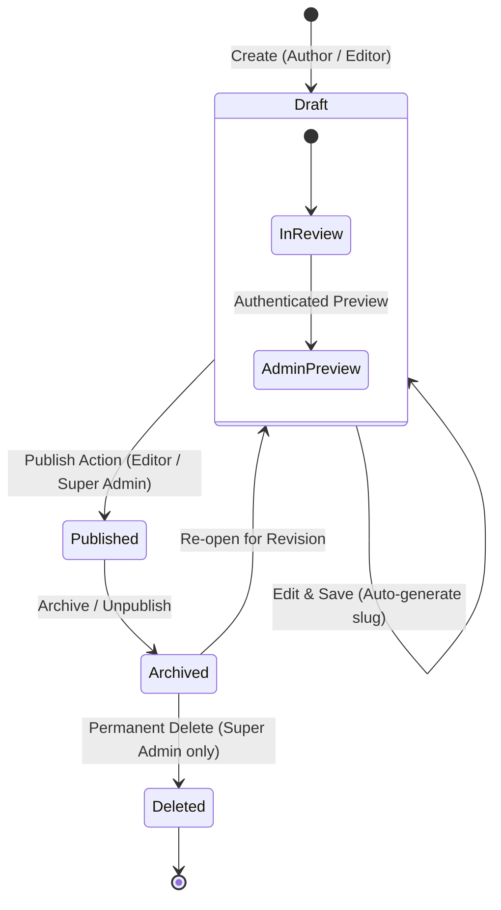

# Admin CMS & Cloudflare R2 Media Architecture

**Project:** Aurelle Spaces  
**Organization:** DRK Information Software Solutions  
**Deployment Target:** Cloudflare Workers, Cloudflare D1 (SQLite), Cloudflare R2  
**Production URL:** `https://aurelle.dsecops88.online`  
**Document Revision:** Prompt 09 — Version 1.0  

---

## 1. Overview & Architectural Principles

The Aurelle Spaces Content Management System (CMS) provides authorized studio directors and editors with a secure, responsive interface to manage architectural portfolio monographs, design disciplines, editorial journal essays, and media assets.

Key principles:
1. **Server-Side Authorization First:** Every content mutation and upload endpoint enforces session verification and granular RBAC checks (`cms:write`, `cms:publish`, `cms:delete`, `media:upload`, `media:delete`).
2. **Edge-Native Relational Persistence:** All metadata and structured case study records persist in Cloudflare D1 via strongly-typed repositories.
3. **Partitioned R2 Media Storage:** Photography assets upload directly to the Cloudflare R2 bucket (`aurelle-media`) with deterministic, partitioned object keys (`projects/{year}/{slug}/{uniqueId}-{filename}`).
4. **Controlled Public Fallback:** Public pages query published D1 records first; if the database is unprovisioned (local development or pre-migration), they fall back gracefully to demonstration datasets without breaking.
5. **Secure Draft Previews:** Draft content is never exposed to unauthenticated public visitors or search engine crawlers. Authenticated previews render with a persistent warning banner and `robots: { index: false, follow: false }`.

---

## 2. CMS Route Hierarchy

```
/admin/
├── (dashboard)/
│   ├── page.tsx                      # Studio Overview & Statistics
│   ├── projects/                     # Portfolio Project List & Filters
│   │   ├── page.tsx
│   │   ├── new/page.tsx              # Create Project Monograph
│   │   └── [id]/page.tsx             # Edit Project Monograph
│   ├── services/                     # Design Disciplines List
│   │   ├── page.tsx
│   │   ├── new/page.tsx              # Create Service Discipline
│   │   └── [id]/page.tsx             # Edit Service Discipline
│   ├── journal/                      # Journal Monographs List
│   │   ├── page.tsx
│   │   ├── new/page.tsx              # Write Article
│   │   └── [id]/page.tsx             # Edit Article
│   ├── media/                        # Cloudflare R2 Media Library
│   │   └── page.tsx
│   ├── enquiries/page.tsx            # Client Consultation Pipeline (Prompt 10)
│   ├── chat/page.tsx                 # Studio Assistant History (Prompt 11)
│   ├── automations/page.tsx          # n8n Event Queue (Prompt 14)
│   └── settings/page.tsx             # Studio & Account Settings
├── preview/
│   ├── project/[id]/page.tsx         # Authenticated Draft Project Preview
│   └── article/[id]/page.tsx         # Authenticated Draft Monograph Preview
└── login/page.tsx                    # Studio Administrator Sign-In
```

---

## 3. Content Lifecycle & Publishing Workflow



### Lifecycle Rules:
- **Draft:** Accessible only within `/admin` or via `/admin/preview/*`. Never visible on public routes (`/portfolio`, `/journal`).
- **Published:** Automatically queried by public pages. Updates trigger cache revalidation.
- **Archived:** Preserves historic slugs and prevents 404 links while removing content from public archives.
- **Permanent Deletion:** Restricted to users with the `cms:delete` permission (Super Admin).

---

## 4. Cloudflare R2 Media Management & Consistency

### Storage Hierarchy
```
aurelle-media/
├── projects/{year}/{slug}/{uniqueId}-{filename}
├── journal/{year}/{slug}/{uniqueId}-{filename}
├── general/{year}/{uniqueId}-{filename}
└── private/{year}/{uniqueId}-{filename}
```

### Upload Pipeline & Consistency Guarantees
1. Client submits file via `POST /api/admin/media/upload` (multipart/form-data).
2. Server validates file extension, file size (max 10 MB), and MIME type (JPEG, PNG, WebP, AVIF).
3. Binary stream uploads to Cloudflare R2 via `putMediaObject()`.
4. Metadata record inserts into D1 `media_assets`.
5. **Rollback Strategy:** If D1 record insertion fails, the newly uploaded R2 object is automatically deleted to prevent orphaned storage waste.
6. **Deletion Safety:** Before deleting any media asset (`DELETE /api/admin/media/[id]`), the system checks reference counts in `project_media` and `journal_articles`. Deletions are blocked if referenced by active content unless an explicit `force=true` parameter is provided.

---

## 5. Public Website & Draft Preview Integration

Public pages (`/portfolio`, `/services`, `/journal`) utilize the unified `src/lib/cms/content-service.ts` layer:
```typescript
// Public Query (Published Only with Controlled Fallback)
const projects = await getPublicProjects();

// Authenticated Preview Query (Draft or Published)
const preview = await getProjectForPreview(idOrSlug);
```

- When D1 is connected and populated, public visitors see live CMS-managed published content.
- Draft previews enforce `requireAdminSession()` and render a prominent amber notification bar:
  `"ADMIN PREVIEW MODE — DRAFT CONTENT — NOT VISIBLE TO PUBLIC VISITORS"`
- Preview responses instruct search engines: `robots: { index: false, follow: false }`.

---

## 6. Audit Logging Matrix

All administrative CMS mutations trigger immutable audit records in the `audit_logs` table:

| Action | Entity Type | Actor | Metadata Captured |
| :--- | :--- | :--- | :--- |
| `project.create` | `project` | Admin User ID | `slug`, `title` |
| `project.update` | `project` | Admin User ID | `slug`, `title` |
| `project.publish` | `project` | Admin User ID | `status: "published"` |
| `project.unpublish` | `project` | Admin User ID | `status: "draft"` |
| `project.delete` | `project` | Admin User ID | None |
| `service.create` | `service` | Admin User ID | `slug`, `title` |
| `service.update` | `service` | Admin User ID | `slug`, `title` |
| `service.delete` | `service` | Admin User ID | None |
| `article.create` | `article` | Admin User ID | `slug`, `title` |
| `article.update` | `article` | Admin User ID | `slug`, `title` |
| `article.publish` | `article` | Admin User ID | `status: "published"` |
| `article.delete` | `article` | Admin User ID | None |
| `media.upload` | `media` | Admin User ID | `key`, `filename`, `size` |
| `media.update_alt` | `media` | Admin User ID | None |
| `media.delete` | `media` | Admin User ID | `key` |

