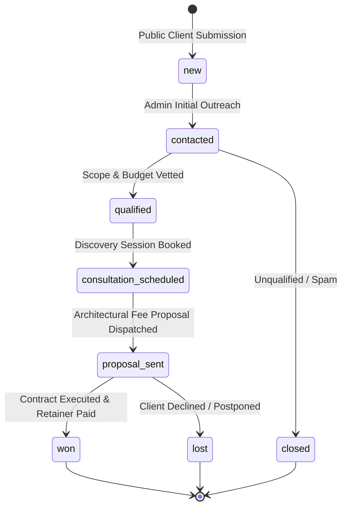

# Enquiry Management, Lead Pipeline & Notification Architecture
**Project:** Aurelle Spaces — Premium Architecture & Interior Design Studio  
**Production Domain:** `https://aurelle.dsecops88.online`  
**Implemented In:** Prompt 10 of 20  
**Status:** Production Ready (Edge D1 Compatible)

---

## 1. Executive Architectural Overview

The **Aurelle Spaces Enquiry Management Engine** provides a secure, resilient, edge-compatible lead intake and administrative management pipeline. Built natively on Cloudflare Pages/Workers and Cloudflare D1, it bridges the gap between public client consultation intake and internal architectural project qualification.

### Key Architectural Tenets:
1. **Edge-Native Integrity:** All operations run on Cloudflare Workers edge runtime with zero Node.js native dependencies. Database access uses parameterized Cloudflare D1 SQL queries.
2. **Multi-Layered Spam & Abuse Prevention:** Built-in honeypot trap, request payload size limiting (32KB), and a persistent IP-based rate limiter stored in Cloudflare D1 (`enquiry_rate_limits`).
3. **Strict Idempotency & Deduplication:** Client-generated idempotency keys (`idempotency_key`) and recent 5-minute duplicate checks prevent double-submissions and network retry glitches without frustrating legitimate prospective clients.
4. **Structured 8-Stage Lead Progression:** Lead triage moves predictably from initial capture (`new`) through consultation, proposal, and contract resolution (`won`/`lost`/`closed`).
5. **Separation of Public vs Internal Data:** Client submissions remain immutable; internal team collaboration occurs via an isolated `enquiry_notes` ledger linked to authenticated administrative profiles.
6. **Decoupled Automation Event Dispatch:** Upon successful intake, an immutable event (`enquiry.created`) is enqueued into `automation_events` in Cloudflare D1, serving as the event source for downstream n8n webhook web workers and email notifications (Prompts 14 & 15).

---

## 2. Public Enquiry Submission Flow & API Contract

### Route Specification
* **Method:** `POST`
* **Path:** `/api/enquiries`
* **Authentication:** Public (Protected by rate limiter, payload validator, and honeypot)
* **Request Encoding:** `application/json` (Strictly enforced, max 32KB)

### Request Payload Schema
```typescript
interface CreateEnquiryPayload {
  name: string;           // 2 - 100 characters, trimmed
  email: string;          // Valid email format, lowercase normalized, max 254 chars
  phone?: string;         // Optional, max 25 characters, trimmed
  projectType: string;    // Discipline ('architecture' | 'interior' | 'turnkey' | 'consultation')
  approximateBudget?: string; // Optional budget tier (e.g., '₹50L - ₹1 Cr')
  location?: string;      // Optional city/site location, max 120 chars
  approximateArea?: string;   // Optional square footage / site extent, max 80 chars
  timeline?: string;      // Optional desired start/completion timeframe, max 80 chars
  message: string;        // 10 - 2000 characters, trimmed
  websiteUrl?: string;    // Invisible honeypot trap (Must be empty or undefined)
  idempotencyKey?: string;// Client-generated UUID string (36 chars)
}
```

### Response Formats

#### Success (HTTP 201 Created)
```json
{
  "success": true,
  "enquiryId": "enq_1732123456789_a1b2c3d4",
  "referenceCode": "AUR-123456",
  "message": "Thank you for sharing your requirements. Your enquiry has been received."
}
```

#### Bot Trapped / Honeypot Triggered (HTTP 200 OK - Silent Absorb)
To frustrate automated scrapers and bots without revealing detection logic:
```json
{
  "success": true,
  "enquiryId": "enq_received",
  "referenceCode": "AUR-000000",
  "message": "Thank you for sharing your requirements. Your enquiry has been received."
}
```

#### Rate Limit Exceeded (HTTP 429 Too Many Requests)
```json
{
  "success": false,
  "error": "Too many enquiry submissions from this IP address. Please wait a few minutes before trying again or contact the studio directly via phone."
}
```

#### Validation Error (HTTP 400 Bad Request)
```json
{
  "success": false,
  "error": "Full Name is required and must be between 2 and 100 characters."
}
```

---

## 3. Server-Side Validation, Constraints & Normalization

All validation logic is housed in `src/lib/validation/enquiry-schema.ts` and executed before database operations:

| Field | Type | Constraint | Normalization |
|---|---|---|---|
| `name` | String | 2 - 100 characters | Trim whitespace, escape control characters |
| `email` | String | Valid RFC 5322 email | Lowercase converted, whitespace trimmed |
| `phone` | String | Optional, max 25 chars | Trimmed |
| `projectType` | Enum | Valid project discipline | Validated against studio offerings |
| `approximateBudget` | String | Optional, max 80 chars | Trimmed |
| `location` | String | Optional, max 120 chars | Trimmed |
| `approximateArea` | String | Optional, max 80 chars | Trimmed |
| `timeline` | String | Optional, max 80 chars | Trimmed |
| `message` | String | 10 - 2000 characters | Trimmed |
| `consent_at` | Timestamp | System generated | Set to ISO 8601 server timestamp at insertion |

---

## 4. Idempotency & Duplicate Submission Protection

To protect against duplicate database records caused by multi-clicking or unstable mobile network retries:
1. **Client-Generated Idempotency Key:** `consultation-form.tsx` generates a unique `idempotencyKey` (UUIDv4) upon component mounting.
2. **Idempotency Key Check:** `/api/enquiries` checks D1 for any enquiry having the identical `idempotency_key`. If found, the existing enquiry record is returned with HTTP 200, bypassing duplicate creation.
3. **Temporal Duplicate Detection:** If `idempotency_key` is absent or different, the backend checks for identical `email` and `project_type` submissions within the preceding 5 minutes (`datetime('now', '-5 minutes')`). If found, it returns the existing reference, ensuring zero duplicate notifications or CRM tasks.

---

## 5. Spam & Abuse Prevention Layer

1. **Honeypot Trap:**
   - Field `websiteUrl` is rendered invisibly in `consultation-form.tsx` using `tabIndex={-1}`, `aria-hidden="true"`, and absolute off-screen positioning.
   - Legitimate human users will not complete this field. If filled, the request is immediately absorbed and discarded silently.
2. **Payload Size Guard:**
   - Raw request body length is checked; payloads exceeding 32,768 bytes (32 KB) are rejected immediately with HTTP 413.
3. **Cloudflare D1 Rate Limiter (`src/lib/security/enquiry-rate-limit.ts`):**
   - Resolves client IP via standard Cloudflare headers (`CF-Connecting-IP`, `X-Forwarded-For`).
   - Tracks IP submission counters in `enquiry_rate_limits`.
   - Threshold: **Maximum 3 submissions per IP per 10-minute sliding window**.
   - Window expiration automatically resets counters; stale records are purged periodically.

---

## 6. Database Schema & Migration (`0004_enquiry_management.sql`)

The migration `migrations/0004_enquiry_management.sql` extends Cloudflare D1 with dedicated columns, indexes, and tables:

```sql
-- 1. Idempotency support in existing enquiries table
ALTER TABLE enquiries ADD COLUMN idempotency_key TEXT;
CREATE UNIQUE INDEX IF NOT EXISTS idx_enquiries_idempotency_key 
  ON enquiries(idempotency_key) WHERE idempotency_key IS NOT NULL;

-- 2. Internal consultation & lead triage notes
CREATE TABLE IF NOT EXISTS enquiry_notes (
  id TEXT PRIMARY KEY,
  enquiry_id TEXT NOT NULL REFERENCES enquiries(id) ON DELETE CASCADE,
  admin_id TEXT NOT NULL REFERENCES admin_users(id),
  note TEXT NOT NULL,
  created_at TEXT NOT NULL DEFAULT (datetime('now')),
  updated_at TEXT NOT NULL DEFAULT (datetime('now'))
);

CREATE INDEX IF NOT EXISTS idx_enquiry_notes_enquiry 
  ON enquiry_notes(enquiry_id, created_at ASC);

-- 3. Persistent IP Rate Limiting for submissions
CREATE TABLE IF NOT EXISTS enquiry_rate_limits (
  ip_address TEXT PRIMARY KEY,
  submission_count INTEGER NOT NULL DEFAULT 1,
  window_start TEXT NOT NULL DEFAULT (datetime('now')),
  last_submission TEXT NOT NULL DEFAULT (datetime('now'))
);
```

---

## 7. Administrative Pipeline & RBAC

The admin lead management console is available under `/admin/enquiries` and protected by server-side session checks and RBAC rules:

### Permission Matrix

| Role | View Pipeline (`/admin/enquiries`) | View Detail (`/admin/enquiries/[id]`) | Update Status | Assign Admin | Add Notes |
|---|:---:|:---:|:---:|:---:|:---:|
| **super_admin** | ✅ Allowed | ✅ Allowed | ✅ Allowed | ✅ Allowed | ✅ Allowed |
| **editor** | ✅ Allowed | ✅ Allowed | ✅ Allowed | ✅ Allowed | ✅ Allowed |
| **viewer** | ✅ Allowed | ✅ Allowed | ❌ Read Only | ❌ Read Only | ❌ Read Only |

### Admin Endpoints
- `GET /api/admin/enquiries`: Filter by `status`, `projectType`, `search`, with pagination and aggregate metrics.
- `PATCH /api/admin/enquiries/[id]/status`: Update lead status (with audit logging).
- `PATCH /api/admin/enquiries/[id]/assign`: Assign or reassign lead to active admin account (with audit logging).
- `GET /api/admin/enquiries/[id]/notes`: Fetch chronological internal team notes.
- `POST /api/admin/enquiries/[id]/notes`: Create a new internal note (attributed to current admin).

---

## 8. Lead Status Lifecycle (8 Stages)

The enquiry pipeline models the operational client engagement workflow of an elite architecture practice:



### Status Definitions:
1. `new`: Inbound submission received, awaiting studio principal review.
2. `contacted`: Initial phone or email outreach conducted by studio coordinator.
3. `qualified`: Scope, budget range, and timeline align with studio engagement thresholds.
4. `consultation_scheduled`: Formal in-person or virtual design consultation scheduled.
5. `proposal_sent`: Comprehensive design brief and architectural fee proposal presented.
6. `won`: Contract executed and initial design retainer secured.
7. `lost`: Proposal declined or project abandoned by client.
8. `closed`: Archived due to non-fit, duplicate submission, or unresponsiveness.

---

## 9. Admin Assignment Mechanics & Audit Logging

- **Assignment Target:** Active administrative accounts with role `super_admin` or `editor`.
- **Unassigned State:** `assigned_admin_id = NULL` visually flags the enquiry in the triage overview as "Unassigned".
- **Audit Logging:** Every status change and assignment generates an immutable entry in the `audit_logs` table capturing:
  - `admin_id`: ID of the acting administrator.
  - `action`: e.g., `enquiry.status_updated`, `enquiry.assigned`, `enquiry_note.created`.
  - `target_type`: `enquiry` / `enquiry_note`.
  - `target_id`: Specific enquiry or note identifier.
  - `details`: JSON payload including previous and new values.

---

## 10. Internal Notes System & Privacy Boundaries

- **Separation of Concerns:** Public enquiry fields remain pristine representations of client input. Internal dialogue, meeting minutes, qualification checklists, and budget observations are stored in `enquiry_notes`.
- **Attribution:** Notes are author-stamped with the admin's ID, displayed with their public display name and role badge.
- **Privacy Assurance:** `enquiry_notes` are strictly quarantined from public APIs and are accessible only through authenticated administrative session endpoints.

---

## 11. Activity Timeline Generation

The enquiry detail view (`/admin/enquiries/[id]`) dynamically synthesizes an activity timeline from multiple sources:
1. **Creation Event:** Timestamped intake details (`created_at`, `consent_at`).
2. **Audit Log Entries:** Historical record of status transitions, reassignments, and administrative interventions.
3. **Internal Notes:** Chronologically integrated discussion points, client meetings, and design scope refinements.

---

## 12. Automation Event Dispatch (`automation_events`)

To decouple the public intake API from external notification delivery, successful enquiry submissions enqueue an event into `automation_events`:

```typescript
await automationRepo.create({
  eventType: 'enquiry.created',
  payload: JSON.stringify({
    enquiryId: enquiry.id,
    referenceCode: enquiry.id.slice(-6).toUpperCase(),
    clientName: enquiry.name,
    clientEmail: enquiry.email,
    projectType: enquiry.project_type,
    location: enquiry.location,
    approximateBudget: enquiry.approximate_budget,
    submittedAt: new Date().toISOString(),
  }),
  status: 'pending',
  retryCount: 0,
});
```

This persistent queue is ready for consumption by:
- **Prompt 14:** n8n Workflow Automation webhooks for CRM synchronization and Slack/Telegram alerts.
- **Prompt 15:** Resend / Cloudflare Workers transactional email dispatches to client and studio directors.

---

## 13. Production Cloudflare Deployment Checklist

When deploying to Cloudflare Pages/Workers:
- [x] Apply D1 migration `0004_enquiry_management.sql` via Wrangler:
  `wrangler d1 execute aurelle-db --file=migrations/0004_enquiry_management.sql`
- [x] Confirm `CF-Connecting-IP` header propagation from Cloudflare edge proxy.
- [x] Verify database read/write permissions for Cloudflare D1 binding `DB`.
- [x] Test rate-limiter reset window behavior under simulated multi-submission conditions.
- [x] Confirm admin RBAC session enforcement across `/admin/enquiries/*`.

